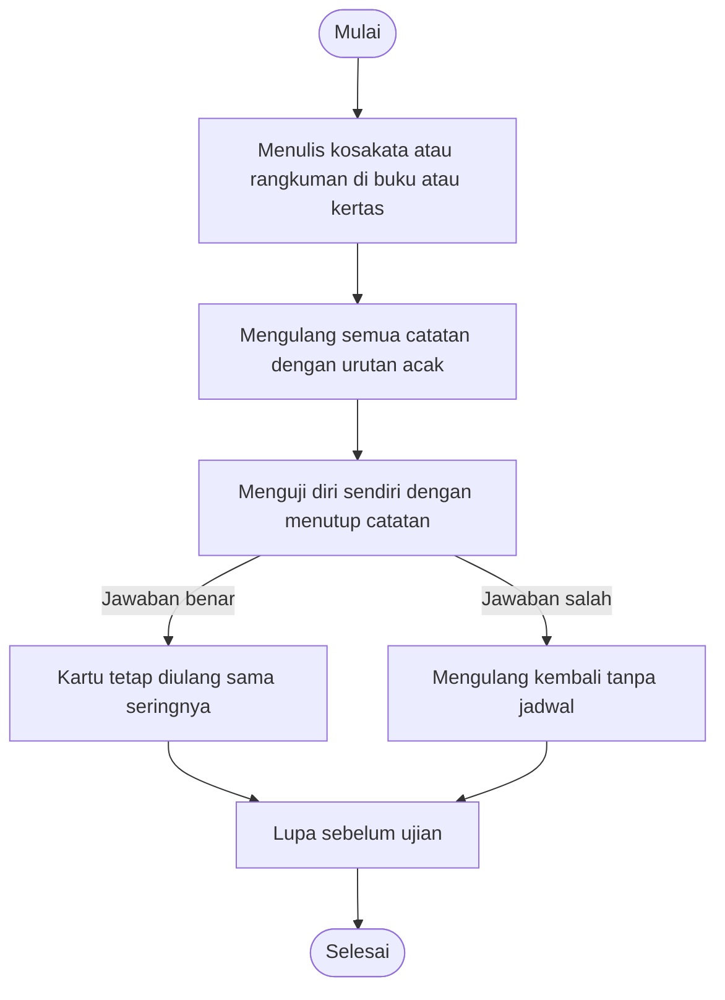
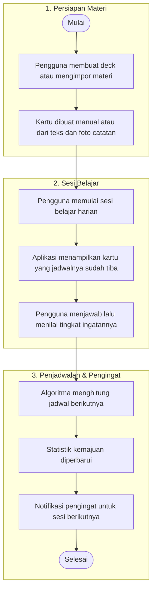

# PROPOSAL AKADEMIK · 2026

# RECALLY
### Aplikasi Flashcard dan Pengulangan Berjarak untuk Menghafal Kosakata dan Materi Ujian

**Dokumen Analisis Kebutuhan Pengguna dan Karakteristik Perangkat Bergerak**  
*Disusun sebagai dasar perancangan dan pengembangan aplikasi mobile RECALLY dengan pendekatan spaced repetition, penyimpanan lokal, dan notifikasi pengingat.*

---

| Identitas | Detail |
| :--- | :--- |
| **Disusun Oleh** | Rizky Muhammad Ristya |
| **Mata Kuliah** | Pemrograman Bergerak |
| **Dosen Pengampu** | Moch Yusuf Asyhari, S.Tr.Kom., M.Kom. |
| **Institusi** | Universitas PGRI Madiun |
| **Tahun** | 2026 |

---

## DAFTAR ISI

- [RINGKASAN EKSEKUTIF](#ringkasan-eksekutif)
- [BAB 1 Latar Belakang](#bab-1-latar-belakang)
  - [1.1 Rumusan Masalah](#11-rumusan-masalah)
  - [1.2 Tujuan Proposal](#12-tujuan-proposal)
  - [1.3 Ruang Lingkup dan Batasan](#13-ruang-lingkup-dan-batasan)
- [BAB 2 Analisis Permasalahan](#bab-2-analisis-permasalahan)
  - [2.1 Sistem yang Berjalan](#21-sistem-yang-berjalan)
  - [2.2 Identifikasi Masalah](#22-identifikasi-masalah)
  - [2.3 Dampak Masalah dan Kebutuhan Solusi](#23-dampak-masalah-dan-kebutuhan-solusi)
- [BAB 3 Analisis Solusi yang Ditawarkan](#bab-3-analisis-solusi-yang-ditawarkan)
  - [3.1 Flowchart Sistem yang Ditawarkan](#31-flowchart-sistem-yang-ditawarkan)
  - [3.2 Arsitektur dan Komponen](#32-arsitektur-dan-komponen)
- [BAB 4 Spesifikasi Pengembang](#bab-4-spesifikasi-pengembang)
  - [4.1 Perangkat Keras](#41-perangkat-keras)
  - [4.2 Perangkat Lunak](#42-perangkat-lunak)
- [BAB 5 Spesifikasi Target](#bab-5-spesifikasi-target)
  - [5.1 Karakteristik Perangkat Bergerak dan Implikasi Desain](#51-karakteristik-perangkat-bergerak-dan-implikasi-desain)
  - [5.2 Pengguna Sasaran](#52-pengguna-sasaran)
  - [5.3 Kebutuhan Fungsional](#53-kebutuhan-fungsional)
  - [5.4 Spesifikasi Aplikasi](#54-spesifikasi-aplikasi)
  - [5.5 Target Mutu](#55-target-mutu)
  - [5.6 Manfaat yang Diharapkan](#56-manfaat-yang-diharapkan)
  - [5.7 Rencana Implementasi Bertahap](#57-rencana-implementasi-bertahap)
  - [5.8 Risiko dan Mitigasi](#58-risiko-dan-mitigasi)
- [BAB 6 Kesimpulan dan Rekomendasi](#bab-6-kesimpulan-dan-rekomendasi)
  - [6.1 Kesimpulan](#61-kesimpulan)
  - [6.2 Rekomendasi](#62-rekomendasi)
- [DAFTAR PUSTAKA](#daftar-pustaka)

---

## RINGKASAN EKSEKUTIF

Menghafal kosakata dan materi ujian sering kurang efektif karena pengulangan dilakukan tanpa jadwal yang terukur. Materi yang telah dikuasai terus diulang, sementara materi yang sulit kurang mendapat perhatian. Akibatnya, waktu belajar tidak sebanding dengan hasil yang diperoleh.

**RECALLY** adalah aplikasi mobile berbasis Flutter yang membantu pengguna menghafal melalui kartu belajar (*flashcard*) dengan jadwal pengulangan berjarak (*spaced repetition*) yang dihitung otomatis berdasarkan penilaian ingatan pengguna. Kartu dapat dibuat secara manual, dari teks, maupun dari foto catatan. Aplikasi mengirim pengingat melalui notifikasi lokal dan tetap dapat digunakan tanpa koneksi internet.

Dokumen ini menyajikan analisis kebutuhan pengguna, karakteristik perangkat bergerak, spesifikasi pengembang, spesifikasi target, serta rencana implementasi sebagai dasar pengembangan aplikasi. Analisis disusun untuk memastikan solusi yang diusulkan sesuai dengan kebutuhan belajar, batasan perangkat, dan ruang lingkup pengembangan.

> **SOROTAN SOLUSI:**  
> Penjadwalan otomatis · Kartu dari teks dan foto · Pembelajaran offline · Pengingat lokal  
> *RECALLY memindahkan beban mengingat jadwal dari pengguna ke sistem, sehingga sesi belajar menjadi lebih terarah dan terukur.*

---

## BAB 1 Latar Belakang

Proses melupakan merupakan bagian alami dari ingatan manusia. Penelitian Hermann Ebbinghaus melalui kurva lupa (*forgetting curve*) menunjukkan bahwa ingatan menurun dengan cepat setelah proses belajar dan melambat setelah pengulangan dilakukan. Temuan tersebut menjadi dasar metode *spaced repetition*, yaitu penjadwalan ulang materi pada interval yang meningkat sesuai kemampuan pengguna mengingatnya.

Dalam praktik belajar sehari-hari, pengulangan sering dilakukan secara acak dari catatan yang sama. Pengguna cenderung mengulang materi yang sudah familiar dan kurang memperhatikan materi yang sulit. Tanpa catatan waktu dan tingkat penguasaan, materi yang terlupakan baru disadari ketika ujian sudah dekat. Pola ini membuat proses belajar kurang efisien dan sulit dievaluasi.

Perangkat mobile menawarkan solusi yang sesuai untuk kebutuhan tersebut. Ponsel selalu tersedia, mendukung sesi belajar singkat di sela aktivitas, serta dapat mengirim notifikasi pada waktu yang ditentukan. Dengan memanfaatkan penyimpanan lokal, kamera, dan notifikasi, aplikasi mobile dapat menjadi media belajar yang terjadwal tanpa bergantung pada koneksi internet.

### 1.1 Rumusan Masalah
1. Bagaimana pengulangan kartu dapat dijadwalkan secara otomatis sesuai tingkat ingatan pengguna?
2. Bagaimana pembuatan kartu dapat dilakukan dengan cepat dari teks maupun foto catatan?
3. Bagaimana pengguna dapat belajar tanpa koneksi internet dan tetap menerima pengingat secara tepat waktu?

### 1.2 Tujuan Proposal
Proposal ini bertujuan menyusun analisis kebutuhan sebagai dasar pengembangan aplikasi RECALLY, dengan sasaran sebagai berikut:
* **Mengidentifikasi masalah belajar:** Mengidentifikasi masalah belajar yang muncul akibat pengulangan tanpa jadwal;
* **Merumuskan kebutuhan:** Merumuskan kebutuhan fungsional dan nonfungsional yang sesuai dengan kebiasaan pengguna;
* **Menetapkan batasan perangkat:** Menetapkan karakteristik perangkat bergerak yang memengaruhi keputusan desain;
* **Menyusun rencana implementasi:** Menyusun rencana implementasi bertahap beserta mitigasi risiko pengembangan.

### 1.3 Ruang Lingkup dan Batasan
* **Sasaran pengguna:** Pelajar SMA, mahasiswa, dan pembelajar bahasa asing yang membutuhkan media hafalan terstruktur.
* **Platform:** Android sebagai platform utama dan iOS sebagai tahap pengembangan lanjutan, dengan satu basis kode Flutter.
* **Cakupan fitur:** Pengelolaan deck dan kartu, sesi belajar, algoritma pengulangan, pengingat, statistik, serta mode offline.
* **Batasan:** Akurasi pengenalan teks bergantung pada kualitas foto; keputusan pengulangan bergantung pada penilaian jujur pengguna; sinkronisasi cloud bersifat opsional pada versi pertama.

---

## BAB 2 Analisis Permasalahan

Bab ini menguraikan proses belajar yang berjalan saat ini, masalah utama yang muncul, serta dampaknya terhadap kebutuhan solusi.

### 2.1 Sistem yang Berjalan
Alur belajar konvensional umumnya dimulai dengan menulis kosakata atau rangkuman pada buku dan kertas. Seluruh catatan kemudian diulang secara acak, lalu diuji dengan cara menutup catatan. Jawaban benar maupun salah tidak diikuti penjadwalan ulang, sehingga intensitas pengulangan cenderung sama untuk semua materi. Gambar 2.1 menggambarkan alur tersebut.

Ketika jawaban dinilai benar, kartu tetap diulang dengan frekuensi yang sama. Ketika jawaban salah, pengguna mengulang kembali tanpa jadwal yang jelas. Pada akhirnya, materi baru disadari terlupakan saat ujian sudah dekat. Pola ini menunjukkan bahwa masalah utama bukan terletak pada kurangnya usaha belajar, melainkan pada tidak adanya mekanisme penjadwalan dan evaluasi yang terukur.

**Gambar 2.1** Alur belajar konvensional yang berjalan saat ini.

> **KELEMAHAN ALUR KONVENSIONAL:**
> * Tidak ada prioritas berdasarkan tingkat kesulitan.
> * Interval pengulangan tidak terukur.
> * Kemajuan belajar tidak terdokumentasi.
> * Media kertas mudah tercecer dan tidak praktis.
> 
> *Dampaknya, pengguna baru menyadari materi yang terlupakan saat mendekati ujian.*

### 2.2 Identifikasi Masalah
Berdasarkan alur tersebut, terdapat lima masalah utama yang perlu diselesaikan oleh aplikasi yang diusulkan:
1. **Pengulangan tidak dijadwalkan:** Kartu yang sudah dikuasai tetap diulang, sedangkan kartu yang sulit kurang mendapat perhatian. Waktu belajar menjadi tidak proporsional dengan tingkat kesulitan materi.
2. **Waktu pengulangan tidak diketahui:** Pengguna tidak memiliki acuan kapan sebuah materi harus diulang agar tetap bertahan hingga ujian.
3. **Pembuatan kartu manual memakan waktu:** Penulisan ulang materi membutuhkan waktu dan menghasilkan format kartu yang tidak konsisten.
4. **Kemajuan belajar tidak terukur:** Tidak ada catatan materi yang telah dikuasai dan yang masih perlu diulang, sehingga evaluasi belajar sulit dilakukan.
5. **Media belajar tidak praktis:** Catatan kertas mudah tercecer dan tidak praktis dibawa ke berbagai tempat.

### 2.3 Dampak Masalah dan Kebutuhan Solusi
Setiap masalah memiliki dampak langsung terhadap proses belajar. Tabel 2.1 memetakan dampak tersebut terhadap kebutuhan solusi yang harus dipenuhi RECALLY.

**Tabel 2.1** Dampak masalah dan kebutuhan solusi

| Masalah | Dampak | Kebutuhan Solusi |
| :--- | :--- | :--- |
| **Pengulangan tanpa jadwal** | Waktu belajar terbuang; kartu sulit terabaikan | Jadwal pengulangan otomatis berbasis penilaian ingatan |
| **Pembuatan kartu manual** | Waktu persiapan tinggi; format tidak konsisten | Pembuatan kartu dari teks dan foto catatan |
| **Tidak ada catatan kemajuan** | Pengguna tidak mengetahui progres belajar | Statistik, riwayat sesi, dan *streak* harian |
| **Ketergantungan tempat dan koneksi** | Sesi belajar sering terlewat | Mode *offline* dan pengingat melalui notifikasi lokal |

---

## BAB 3 Analisis Solusi yang Ditawarkan

Bab ini menjelaskan solusi yang ditawarkan RECALLY serta arsitektur komponen yang mendukung perancangan.

### 3.1 Flowchart Sistem yang Ditawarkan
RECALLY mengubah alur belajar konvensional menjadi siklus belajar yang terukur. Pengguna menyiapkan materi, aplikasi memilih kartu yang sudah jatuh tempo, pengguna menilai tingkat ingatan, dan algoritma menentukan waktu pengulangan berikutnya. Hasil penilaian kemudian tercermin pada statistik dan pengingat sesi berikutnya. Alur lengkap ditunjukkan pada Gambar 3.1.

**Gambar 3.1** Alur sistem RECALLY dari persiapan materi hingga pengingat sesi berikutnya.

#### Tahapan Utama:
1. Pengguna membuat deck atau mengimpor materi.
2. Kartu dibuat manual atau dari teks dan foto catatan.
3. Pengguna memulai sesi belajar harian.
4. Aplikasi menampilkan kartu yang jadwalnya sudah tiba.
5. Pengguna menjawab lalu menilai tingkat ingatannya.
6. Algoritma menghitung jadwal berikutnya untuk kartu tersebut.
7. Statistik kemajuan diperbarui.
8. Notifikasi pengingat untuk sesi berikutnya.

> **PRINSIP KERJA:**  
> Kartu yang dinilai sulit muncul lebih sering, sedangkan kartu yang telah dikuasai muncul lebih jarang. Seluruh perhitungan jadwal dilakukan di perangkat sehingga sesi belajar tetap berjalan tanpa koneksi internet.

### 3.2 Arsitektur dan Komponen
Arsitektur RECALLY dirancang sederhana dan berorientasi *offline*. Seluruh data belajar disimpan di perangkat, sedangkan layanan *cloud* bersifat opsional dan ditambahkan pada tahap lanjutan.

**Tabel 3.1** Arsitektur dan komponen sistem

| Komponen | Peran |
| :--- | :--- |
| **Aplikasi mobile (Flutter)** | Antarmuka deck, kartu, sesi belajar, statistik, dan pengaturan |
| **Penyimpanan lokal (`sqflite` atau `Hive`)** | Menyimpan deck, kartu, dan jadwal pengulangan di perangkat |
| **Mesin pengulangan** | Menghitung jadwal berikutnya dari penilaian pengguna (lupa, ragu, ingat) |
| **Notifikasi lokal** | Mengirim pengingat harian pada jam yang ditentukan |
| **Pengenalan teks (ML Kit)** | Mengubah foto catatan menjadi teks kartu di perangkat |
| **Sinkronisasi cloud (opsional)** | Cadangan dan pemulihan data lintas perangkat dengan Firebase |

*Prinsip arsitektur:* Data belajar disimpan di perangkat secara default sehingga aplikasi tetap berfungsi tanpa koneksi. Sinkronisasi cloud tidak menjadi ketergantungan utama dan dapat diaktifkan sesuai kebutuhan pengguna.

---

## BAB 4 Spesifikasi Pengembang

Bab ini menetapkan kebutuhan perangkat keras dan perangkat lunak yang diperlukan untuk membangun, menguji, dan memelihara aplikasi RECALLY.

### 4.1 Perangkat Keras
Perangkat keras dipilih dengan mempertimbangkan kebutuhan pengembangan lintas platform, pengujian kamera, notifikasi, dan performa aplikasi.

**Tabel 4.1** Spesifikasi perangkat keras

| No. | Perangkat | Spesifikasi dan Keterangan |
| :---: | :--- | :--- |
| 1 | **Laptop pengembangan** | RAM minimal 8 GB (disarankan 16 GB untuk emulator); penyimpanan minimal 20 GB; prosesor mendukung virtualisasi. |
| 2 | **Laptop Mac (untuk iOS)** | Diperlukan untuk Xcode dan build iOS; disiapkan pada tahap pengembangan lanjutan setelah Android. |
| 3 | **Perangkat uji Android** | Ponsel fisik untuk menguji kamera, notifikasi, penyimpanan, dan performa aplikasi. |
| 4 | **Perangkat uji iOS** | iPhone untuk pengujian pada prioritas kedua setelah Android. |

### 4.2 Perangkat Lunak
Perangkat lunak berikut digunakan untuk membangun antarmuka, menyimpan data, menjadwalkan pengulangan, dan mengirim pengingat.

**Tabel 4.2** Spesifikasi perangkat lunak

| No. | Kebutuhan | Keterangan |
| :---: | :--- | :--- |
| 1 | **Flutter (Dart)** | Framework utama untuk Android dan iOS dengan satu basis kode. |
| 2 | **`sqflite` atau `Hive`** | Penyimpanan lokal untuk deck, kartu, dan jadwal pengulangan. |
| 3 | **`flutter_local_notifications`** | Pengingat belajar harian pada jam yang ditentukan pengguna. |
| 4 | **`flutter_tts`** | Pengucapan kosakata untuk mendukung latihan listening. |
| 5 | **Google ML Kit Text Recognition** | Pengenalan teks dari foto catatan langsung di perangkat. |
| 6 | **`provider` atau `Riverpod`** | Pengelolaan state aplikasi agar antarmuka tetap konsisten. |
| 7 | **Firebase Auth & Firestore (opsional)** | Login dan sinkronisasi cloud pada tahap lanjutan. |
| 8 | **Android Studio / VS Code, Git, GitHub** | Lingkungan pengembangan dan kontrol versi. |

---

## BAB 5 Spesifikasi Target

Bab ini menjelaskan karakteristik perangkat bergerak, pengguna sasaran, kebutuhan fungsional, spesifikasi aplikasi, target mutu, dan rencana implementasi RECALLY.

### 5.1 Karakteristik Perangkat Bergerak dan Implikasi Desain
Keputusan desain RECALLY dipengaruhi oleh kondisi penggunaan perangkat bergerak. Tabel 5.1 merangkum karakteristik tersebut beserta implikasinya.

**Tabel 5.1** Karakteristik perangkat bergerak dan implikasi desain

| Karakteristik | Kondisi Pengguna | Implikasi Desain |
| :--- | :--- | :--- |
| **Layar kecil dan sentuh** | Dioperasikan sering dengan satu tangan | Tombol besar (minimal 44 × 44 px) dan navigasi tab bawah |
| **Waktu belajar singkat** | Sesi belajar di sela aktivitas | Sesi harian 5–10 menit dengan jumlah kartu jatuh tempo |
| **Notifikasi** | Pengguna perlu diingatkan waktu belajar | Notifikasi lokal pada jam yang ditentukan pengguna |
| **Konektivitas tidak stabil** | Belajar di tempat tanpa internet | Mode *offline* penuh; sinkronisasi hanya bila tersedia |
| **Baterai dan penyimpanan terbatas** | Gambar dan audio memakan ruang | Kompresi foto dan audio sesuai kebutuhan |
| **Beragam perangkat** | Versi Android dan iOS berbeda | Basis kode tunggal Flutter dan uji pada beberapa perangkat |

### 5.2 Pengguna Sasaran
* **Pelajar SMA:** Pelajar SMA yang menghafal rumus, sejarah, atau istilah untuk ujian.
* **Mahasiswa:** Mahasiswa yang menghafal istilah teknis atau materi ujian.
* **Pembelajar bahasa asing:** Pembelajar bahasa asing yang menghafal kosakata dan pelafalan.

### 5.3 Kebutuhan Fungsional
Kebutuhan fungsional berikut menjadi acuan utama dalam perancangan antarmuka dan alur sistem.

**Tabel 5.2** Kebutuhan fungsional

| Kode | Kebutuhan | Pelaku |
| :---: | :--- | :---: |
| **KF-1** | Pengguna dapat membuat deck dan kartu depan serta belakang. | Pengguna |
| **KF-2** | Pengguna dapat membuat kartu dari teks atau foto catatan. | Pengguna |
| **KF-3** | Pengguna dapat memulai sesi belajar yang berisi kartu jatuh tempo. | Pengguna |
| **KF-4** | Pengguna menilai tingkat ingatan (lupa, ragu, ingat) untuk setiap kartu. | Pengguna |
| **KF-5** | Sistem menghitung jadwal pengulangan berikutnya setelah setiap penilaian. | Sistem |
| **KF-6** | Pengguna menerima notifikasi pengingat pada jam yang dipilih. | Pengguna |
| **KF-7** | Pengguna melihat statistik kemajuan dan *streak* belajar. | Pengguna |
| **KF-8** | Pengguna mendengarkan pengucapan kosakata. | Pengguna |
| **KF-9** | Pengguna dapat mengekspor dan mengimpor deck. | Pengguna |
| **KF-10** | Aplikasi tetap berfungsi tanpa koneksi internet. | Sistem |

### 5.4 Spesifikasi Aplikasi

**Tabel 5.3** Spesifikasi aplikasi

| Aspek | Target |
| :--- | :--- |
| **Platform** | Android sebagai platform utama (minimal Android 8.0); iOS sebagai pengembangan lanjutan |
| **Fitur utama** | Deck dan kartu, sesi pengulangan berjarak, pengingat, statistik, pengucapan, offline, ekspor dan impor |
| **Data per kartu** | Teks depan dan belakang, tingkat ingatan terakhir, tanggal jatuh tempo berikutnya |
| **Tampilan** | Minimalis dan profesional dengan palet navy (`#1B2A41`), oranye (`#E07A1F`), dan krem (`#F4F1EC`) |
| **Batasan** | Berkas foto maksimal 5 MB; teks dari foto dapat keliru pada tulisan tangan |

### 5.5 Target Mutu

**Tabel 5.4** Target mutu aplikasi

| Aspek | Target Usulan |
| :--- | :--- |
| **Kemudahan penggunaan** | Pengguna dapat membuat deck dan memulai sesi kurang dari 3 menit |
| **Kinerja** | Kartu berikutnya tampil kurang dari 300 milidetik setelah penilaian |
| **Keandalan** | Data kartu dan jadwal tidak hilang saat aplikasi ditutup paksa |
| **Privasi** | Data belajar disimpan di perangkat secara default; akun dilindungi login dan HTTPS |
| **Efektivitas** | Kartu yang dikuasai muncul lebih jarang daripada kartu yang sulit, dibuktikan dari statistik uji coba |

### 5.6 Manfaat yang Diharapkan

**Tabel 5.5** Manfaat yang diharapkan

| Pengguna | Manfaat |
| :--- | :--- |
| **Pelajar dan Mahasiswa** | Pengulangan terarah, waktu persiapan kartu lebih singkat, dan progres belajar terlihat jelas |

### 5.7 Rencana Implementasi Bertahap
Pengembangan dilakukan secara bertahap agar setiap komponen dapat diuji sebelum fitur berikutnya ditambahkan.
1. **Validasi kebutuhan:** Konfirmasi kebutuhan calon pengguna dan penyesuaian ruang lingkup.
2. **Perancangan UI dan alur:** Susun layar *onboarding*, deck, sesi belajar, dan statistik.
3. **Pembangunan inti:** Bangun penyimpanan lokal, mesin pengulangan, dan pengelolaan kartu.
4. **Fitur lanjutan:** Tambahkan pengenalan teks dari foto, pengucapan, notifikasi, dan statistik.
5. **Pengujian:** Uji fungsi, mode offline, dan notifikasi pada perangkat Android serta iOS.
6. **Uji coba terbatas dan evaluasi:** Kumpulkan umpan balik pengguna dan lakukan perbaikan akhir sebelum rilis.

### 5.8 Risiko dan Mitigasi

**Tabel 5.6** Risiko dan mitigasi

| Risiko | Kemungkinan | Dampak | Mitigasi |
| :--- | :---: | :---: | :--- |
| **Penilaian diri tidak jujur** | Sedang | Jadwal tidak sesuai kemampuan | Panduan penilaian yang jelas dan statistik kesalahan |
| **Foto sulit dibaca** | Sedang | Kartu berisi teks keliru | Pratinjau hasil OCR yang dapat diedit sebelum disimpan |
| **Notifikasi tidak terkirim** | Sedang | Pengguna melewatkan sesi belajar | Uji izin notifikasi dan penjadwalan ulang setelah perangkat *restart* |
| **Keterbatasan kuota layanan AI** | Sedang | Pembuatan kartu otomatis terhenti | Batasi jumlah permintaan dan sediakan mode manual |
| **Kebutuhan perangkat Mac untuk iOS** | Tinggi | *Build* iOS tidak dapat disiapkan | Rencanakan iOS sebagai tahap lanjutan |

---

## BAB 6 Kesimpulan dan Rekomendasi

### 6.1 Kesimpulan
RECALLY menjawab kebutuhan belajar terjadwal dengan memanfaatkan kemampuan perangkat mobile, yaitu penyimpanan lokal, notifikasi, dan kamera. Dengan cakupan fitur prioritas dan arsitektur yang sederhana, aplikasi dapat dikembangkan secara realistis dalam tugas mata kuliah Pemrograman Bergerak.

Analisis menunjukkan bahwa masalah utama bukan terletak pada kurangnya materi belajar, melainkan pada ketiadaan mekanisme pengulangan yang terukur. Penjadwalan otomatis, pembuatan kartu dari teks dan foto, serta mode *offline* menjadi tiga kemampuan inti yang perlu diprioritaskan.

### 6.2 Rekomendasi
* **Akademik:** Verifikasi seluruh referensi dan sesuaikan format sitasi dengan pedoman penulisan yang berlaku.
* **Validasi:** Lakukan uji coba terbatas dengan beberapa pengguna untuk mengukur kemudahan penggunaan dan efektivitas jadwal pengulangan.
* **Pengujian:** Uji notifikasi, mode *offline*, dan pemulihan data pada beberapa perangkat Android sebelum rilis.
* **Pengembangan:** Siapkan rencana pengembangan iOS dan sinkronisasi cloud sebagai tahap lanjutan agar tidak mengganggu pencapaian versi pertama.

> **LANGKAH BERIKUTNYA:**  
> 1. Fokuskan versi pertama pada alur inti: buat deck, mulai sesi, nilai ingatan, dan lihat jadwal berikutnya.  
> 2. Setelah alur inti stabil, tambahkan fitur pendukung seperti OCR, pengucapan, statistik lanjutan, dan sinkronisasi.

---

## DAFTAR PUSTAKA

1. Ebbinghaus, H. (1885). *Über das Gedächtnis: Untersuchungen zur experimentellen Psychologie*. Duncker & Humblot.
2. Firebase. (n.d.). *Firebase Documentation*. https://firebase.google.com/docs
3. Flutter Team. (n.d.). *Flutter Documentation*. https://docs.flutter.dev
4. Google. (n.d.). *ML Kit Text Recognition*. https://developers.google.com/ml-kit/vision/text-recognition
5. Republik Indonesia. (2022). *Undang-Undang Nomor 27 Tahun 2022 tentang Pelindungan Data Pribadi*.
6. sqflite. (n.d.). *Flutter Package*. https://pub.dev/packages/sqflite
7. SuperMemo. (n.d.). *SM-2 Algorithm*. Wikipedia.
8. flutter_local_notifications. (n.d.). *Flutter Package*. https://pub.dev/packages/flutter_local_notifications
9. Wozniak, P. A. (1990). *Application of a computer to improve the results obtained in working with the SuperMemo method*.